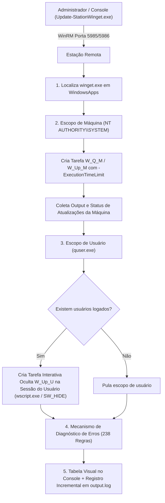
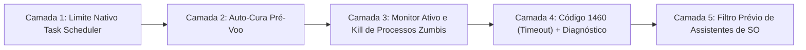

# Documentação Técnica e Especificação de Arquitetura: Remote-WinGet

**Projeto:** Orquestrador Remoto de Atualizações de Aplicativos via WinRM & WinGet  
**Ambiente Alvo:** Windows 10, Windows 11 e Windows Server  
**Localização do Projeto:** `C:\Temp\Remote-WinGet\`  
**Artefatos Principais:** `Update-StationWinget.ps1`, `Update-StationWinget.exe`, `Build-Executable.ps1`, `output.log`

---

## 1. Visão Geral e Desafios de Engenharia

O projeto **Remote-WinGet** foi concebido para resolver o problema de gerenciar, consultar, atualizar e instalar aplicativos em massa em estações de trabalho Windows corporativas a partir de um ponto central, utilizando o catálogo do **Windows Package Manager (WinGet)** sem a necessidade de agentes pesados de terceiros.

### Desafios Críticos Enfrentados e Solucionados:

1. **Problema do Segundo Salto do WinRM (Double Hop):**
   - Conexões remotas normais do WinRM não delegam credenciais para a rede externa, impedindo o WinGet de baixar instaladores da internet.
   - *Solução:* Disparo de Tarefas Agendadas locais sob o contexto de alta permissão `NT AUTHORITY\SYSTEM` (Escopo de Máquina) e sob a conta do usuário logado (Escopo de Usuário). Tarefas agendadas locais possuem identidade de rede completa e não sofrem a restrição do segundo salto.

2. **Ambiente Headless em Sessão 0 (S0 Isolation):**
   - Comandos disparados remotamente executam na Sessão 0 isolada do Windows, onde **não existe interface gráfica (GUI)**.
   - Instaladores que exigem caixas de diálogo ou instaladores com assistente de tela interativa (ex: *Assistente de Atualização do Windows*) congelam indefinidamente esperando um clique do mouse que nunca existirá.
   - *Solução:* Parâmetros rígidos de modo silencioso (`--silent --disable-interactivity`), filtro prévio de ferramentas de migração de SO e a **Arquitetura Anti-Travamento em 5 Camadas**.

3. **Modo de Linguagem Restrita do WinRM (ConstrainedLanguage Mode):**
   - Ambientes com políticas de segurança ativas (AppLocker / Device Guard) forçam o WinRM em modo de linguagem restrita, bloqueando tipos .NET avançados.
   - *Solução:* O orquestrador executa chamadas leves de comandos nativos do Windows (`schtasks.exe`, `quser.exe`, `Get-CimInstance`) e delega a execução complexa para o executável local do WinGet.

4. **Multi-Escopo (Máquina vs. Perfil de Usuário):**
   - Alguns programas (como Chrome, 7-Zip, VLC) instalam em `Program Files` para todos os usuários (`NT AUTHORITY\SYSTEM`), enquanto outros (como Teams Classic, VS Code User, Spotify) instalam exclusivamente no `%LOCALAPPDATA%` do usuário logado.
   - *Solução:* O script faz uma varredura dupla: primeiro em nível de máquina e depois detecta dinamicamente via `quser.exe` quem está logado na estação e dispara tarefas no contexto desse usuário.

5. **Silêncio Absoluto na Sessão Interativa (Eliminação de Piscar de Janela de Console):**
   - Ao executar tarefas interativas no contexto do usuário logado (`-LogonType Interactive`), chamar diretamente o `cmd.exe` faz o Windows alocar um console host (`conhost.exe`), exibindo uma janela preta na tela do usuário (a flag `-Hidden` do Agendador de Tarefas oculta a tarefa apenas no MMC, não a janela de console do processo filho).
   - *Solução:* Foi integrado um wrapper invisível em VBScript executado pelo `wscript.exe` (subsistema GUI do Windows). O `wscript.exe` dispara o `cmd.exe` com `WindowStyle = 0` (`SW_HIDE`), suprimindo 100% qualquer janela visível ou piscar de tela para o usuário, capturando o código de retorno e redirecionando a saída normalmente para arquivo temporário.

---

## 2. Diagrama de Fluxo e Arquitetura



---

## 3. A Arquitetura Anti-Travamento em 5 Camadas (Anti-Hang)

Para garantir que nenhuma estação de trabalho fique presa indefinidamente em uma atualização, foi incorporada a função `Invoke-WingetTask` com 5 camadas ativas de proteção:



1. **Camada 1 — Limite Rígido Nativo do Windows (`-ExecutionTimeLimit`):**
   - O agendador do Windows é configurado nativamente com `[TimeSpan]::FromSeconds($MaxWaitSeconds + 15)`.
   - Se a conexão cair ou a sessão for interrompida, o próprio kernel do Windows finaliza a tarefa compulsoriamente.
2. **Camada 2 — Auto-Cura Pré-Voo (Pre-Flight Cleanup):**
   - Antes de iniciar qualquer tarefa, o script verifica se existe uma tarefa anterior presa com o mesmo nome. Se houver, chama `Stop-ScheduledTask` e `Unregister-ScheduledTask` para liberar travas de arquivo.
3. **Camada 3 — Matança Forçada da Árvore de Processos Órfãos (Active Process Tree Kill):**
   - Ao estourar o tempo limite (`$waited -ge $MaxWaitSeconds`):
     - Chama `Stop-ScheduledTask`.
     - Varre via `Get-CimInstance Win32_Process` buscando por processos associados (`winget.exe`, `cmd.exe`, `setup.exe`, `vs_Professional.exe`, `Windows10Upgrade*`) e aplica `Stop-Process -Force`.
     - Isso evita que o instalador segure o mutex do Windows Installer (`1618 - ERROR_INSTALL_ALREADY_RUNNING`).
4. **Camada 4 — Mapeamento do Código de Saída `1460` (`ERROR_TIMEOUT`):**
   - Em caso de timeout, a função retorna explicitamente o código `1460`.
   - O switch de status registra `Falhou (Tempo Limite Excedido: 900s)` e a base de diagnóstico explica a causa e recomenda estender o timeout (`-TaskTimeoutSeconds`) ou adicionar o pacote à lista de exceções (`-ExcludePackages`).
5. **Camada 5 — Filtro Preventivo de Assistentes de Migração de SO:**
   - Pacotes conhecidos por exigir interação de tela cheia (`Microsoft.UpdateAssistant*`, `Microsoft.WindowsInstallationAssistant*`) são detectados antes do início e marcados automaticamente como `Ignorado (Assistente de SO - Incompativel com Sessao 0)`.

---

## 4. O Mecanismo de Diagnóstico e Base de Conhecimento (238 Casos)

O script incorpora o hashtable `$script:WingetKnowledgeBase`, mapeando detalhadamente mais de 238 cenários de falha. Quando um pacote falha, o script correlaciona o código de saída e trechos de erro do log, gerando uma explicação didática no console e no arquivo de log.

### Categorias Mapeadas na Base:

| Categoria | Faixa de Códigos / Exemplos | Causa Típica |
| :--- | :--- | :--- |
| **Erros Oficiais do WinGet CLI** | `0x8A150001` até `0x8A150110` | Falhas internas, repositório indisponível, hash incorreto, dependência ausente. |
| **Windows Installer (MSI)** | `1601`, `1602`, `1603`, `1618`, `1619`, `1625`, `3010` | Instalação paralela em andamento (1618), cancelamento pelo usuário, reinicialização pendente (3010). |
| **Erros de Sistema Win32** | `1`, `2`, `5`, `1460`, `2147942405` | Acesso negado (5), arquivo não encontrado (2), timeout excedido (1460). |
| **Instaladores Executáveis (Inno, NSIS, Burn, InstallShield)** | Códigos específicos de retorno de vendors | Parâmetro silencioso rejeitado, espaço em disco insuficiente, versão mais nova já instalada. |
| **Rede, Conectividade e TLS** | `0x80072EE7`, `0x80072F8F`, etc. | DNS inacessível, relógio da máquina desincronizado (falha SSL), bloqueio de proxy corporativo. |
| **Falha de Integridade / Checksum** | `0x8A15000F` (`HASH_MISMATCH`) | O download foi corrompido ou o fornecedor atualizou o arquivo no servidor antes de atualizar o manifesto. |

### Fluxo de Análise da Falha:
1. Converte códigos decimais negativos para formato Hexadecimal (`0x8A15xxxx`).
2. Procura correspondência exata no catálogo `$script:WingetKnowledgeBase`.
3. Se o código for genérico (como `1603` ou `1`), realiza uma análise semântica por expressões regulares no trecho final de saída (`$errSnippet`).
4. Apresenta o resultado com três campos:
   - **Categoria:** Nome técnico do erro.
   - **Causa Provável:** O que originou a falha no sistema operacional.
   - **Sugestões de Ação:** 2 a 4 passos práticos para o administrador resolver.

---

## 5. Arquitetura de Logs Centralizados e Incrementais (`output.log`)

Todos os logs de execuções (seja de uma única máquina ou de lotes de centenas de estações) convergem para o arquivo único [`output.log`](file:///C:/Temp/Remote-WinGet/output.log).

### Diretrizes de Registro:
1. **Gravação Incremental (Append):** O arquivo nunca é sobrescrito. Cada nova execução adiciona seu bloco ao final utilizando codificação `UTF-8 com BOM` (`[System.Text.UTF8Encoding]::new($true)`), garantindo que acentos e caracteres especiais abram perfeitamente no Bloco de Notas ou VS Code.
2. **Delimitação Cronológica e Duração:**
   - **Cabeçalho:** `EXECUÇÃO INICIADA EM: dd/MM/yyyy HH:mm:ss | ALVO: <NomeDaEstação>`
   - **Corpo:** Cópia idêntica de todas as mensagens de console, tabelas formatadas e saídas do Winget.
   - **Rodapé:** `EXECUÇÃO CONCLUÍDA EM: dd/MM/yyyy HH:mm:ss | DURAÇÃO: XXm YYs`

---

## 6. Encapsulamento em Executável Nativo (`Update-StationWinget.exe`)

Para garantir portabilidade e contornar políticas de segurança locais (`ExecutionPolicy Restricted`), o projeto inclui um compilador C# nativo em [`Build-Executable.ps1`](file:///C:/Temp/Remote-WinGet/Build-Executable.ps1).

### Características Técnicas do Executável:
- **Tamanho:** Apenas ~169 KB.
- **Compilação 100% Nativa:** Utiliza o compilador C# embutido no Windows (`C:\Windows\Microsoft.NET\Framework64\v4.0.30319\csc.exe`). Não requer instalação de SDK, .NET moderno ou módulos externos.
- **Recurso Embutido:** O script `Update-StationWinget.ps1` é inserido diretamente dentro do assembly binário através da flag `/resource:...,Script.ps1`.
- **Passagem Transparente de Parâmetros:** A classe `Program` em C# utiliza a regra de escape padrão do Windows (`CommandLineToArgvW`), repassando argumentos com espaços, aspas e wildcards diretamente para o motor do PowerShell.
- **Console Subsystem:** Compilado com `/target:exe`, preservando saída colorida nativa (`ConsoleColor`), tabelas horizontais e suporte a pipes.

---

## 7. Guia Completo de Parâmetros e Exemplos (1 Exemplo por Parâmetro)

O script foi projetado para operar em **Modo Seguro por padrão**. Se for executado sem parâmetros (`.\Update-StationWinget.ps1` ou `Update-StationWinget.exe`), ele exibe automaticamente o manual de ajuda sem disparar nenhuma ação na rede.

| Nº | Parâmetro | Tipo | Descrição | Exemplo de Linha de Comando |
| :---: | :--- | :---: | :--- | :--- |
| **1** | `-ComputerName` | `string[]` | Define o computador remoto alvo (aceita múltiplos em array). | `.\Update-StationWinget.ps1 -ComputerName 'estacao061'` |
| **2** | `-ComputerFile` | `string` | Caminho de arquivo `.txt` com lista de computadores (um por linha). | `.\Update-StationWinget.ps1 -ComputerFile 'C:\Temp\Remote-WinGet\computadores.txt'` |
| **3** | `-Update` | `switch` | Aplica as atualizações de fato de forma silenciosa. | `.\Update-StationWinget.ps1 -ComputerName 'estacao061' -Update` |
| **4** | `-PackageId` | `string` | Filtra a ação para apenas um aplicativo específico (aceita wildcards `*`). | `.\Update-StationWinget.ps1 -ComputerName 'estacao061' -PackageId 'VideoLAN.VLC'` |
| **5** | `-InstallPackage` | `string` | Instala um novo programa pelo seu ID do catálogo Winget. | `.\Update-StationWinget.ps1 -ComputerName 'estacao061' -InstallPackage '7zip.7zip'` |
| **6** | `-ExcludePackages` | `string[]` | Lista de IDs ou nomes a ignorar durante a atualização. | `.\Update-StationWinget.ps1 -ComputerName 'estacao061' -Update -ExcludePackages @('Microsoft.Teams.Classic', '*Dell*')` |
| **7** | `-IncludeSkipped` | `switch` | Exibe os pacotes ignorados por exceção na tabela de resumo final. | `.\Update-StationWinget.ps1 -ComputerName 'estacao061' -Update -ExcludePackages @('Zoom.Zoom') -IncludeSkipped` |
| **8** | `-TaskTimeoutSeconds` | `int` | Tempo limite customizado por pacote em segundos (Padrão: 900s / 15 min). | `.\Update-StationWinget.ps1 -ComputerName 'estacao061' -Update -TaskTimeoutSeconds 1800` |
| **9** | `-Credential` | `PSCredential` | Fornece credenciais administrativas explícitas para autenticação no WinRM. | `.\Update-StationWinget.ps1 -ComputerName 'estacao061' -Credential (Get-Credential) -Update` |
| **10** | `-PassThru` | `switch` | Retorna objetos estruturados no pipeline para exportação em CSV ou GridView. | `.\Update-StationWinget.ps1 -ComputerName 'estacao061' -PassThru \| Export-Csv -Path 'C:\Temp\Remote-WinGet\pendentes.csv' -NoTypeInformation -Encoding UTF8` |
| **11** | `-Help` | `switch` | Exibe o manual completo de ajuda e exemplos práticos. | `.\Update-StationWinget.ps1 -Help` |

### Mega Exemplo Combinado de Produção:
```powershell
.\Update-StationWinget.ps1 -ComputerFile 'C:\Temp\Remote-WinGet\computadores.txt' `
                          -Update `
                          -ExcludePackages @('Microsoft.Teams*', 'Veeam*') `
                          -TaskTimeoutSeconds 1200 `
                          -IncludeSkipped `
                          -PassThru | Export-Csv -Path 'C:\Temp\Remote-WinGet\resultado_lote.csv' -NoTypeInformation -Encoding UTF8
```

*(O comando acima funciona de forma idêntica substituindo `.\Update-StationWinget.ps1` por `.\Update-StationWinget.exe`).*

---

## 8. Procedimentos de Manutenção e Recompilação

Caso seja necessário modificar qualquer regra de diagnóstico, adicionar novos filtros ou alterar parâmetros no script [`Update-StationWinget.ps1`](file:///C:/Temp/Remote-WinGet/Update-StationWinget.ps1):

1. Edite o arquivo `.ps1` com as alterações necessárias.
2. Abra o terminal na pasta `C:\Temp\Remote-WinGet`.
3. Execute o script de build:
   ```powershell
   .\Build-Executable.ps1
   ```
4. O novo binário [`Update-StationWinget.exe`](file:///C:/Temp/Remote-WinGet/Update-StationWinget.exe) será gerado em 2 segundos, já pronto para distribuição em estações de trabalho e servidores.
